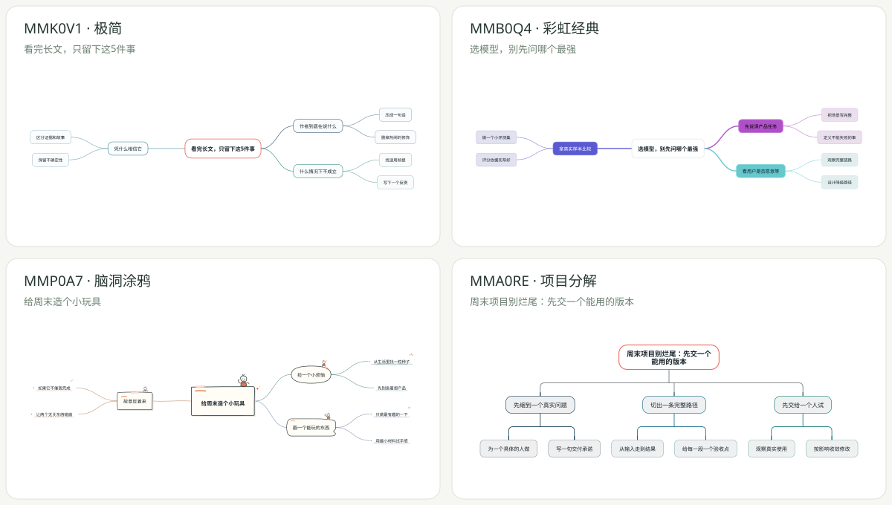
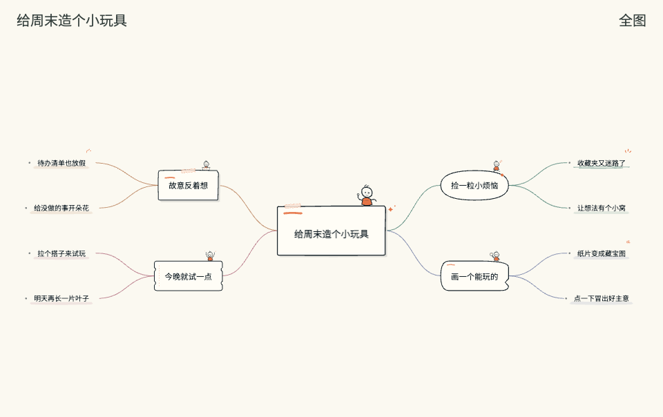

# Mindbox

[English](README.md) · **简体中文**

[](https://github.com/MarkingYang/mindbox/releases/latest)
[](LICENSE)

**把想法展开，让思考可见。**

把笔记、文档和还没理顺的想法，变成可编辑的思维导图。Mindbox 是一份带有 **16 套完整样式**的 Agent Skill，交付**一个可交互的 HTML 文件**，可以离线打开、继续修改、直接分享。

[在线体验](https://markingyang.github.io/mindbox/) · [浏览 16 份范例](https://markingyang.github.io/mindbox/showcase/index.html) · [开始安装](#安装一次说一句就开始) · [下载 v1.0.2](https://github.com/MarkingYang/mindbox/releases/tag/v1.0.2)

[](https://markingyang.github.io/mindbox/showcase/index.html)

## 安装一次，说一句就开始

需要 **Node.js 22.20+**，以及能运行本地 Skill 的 AI 助手。选择你正在使用的助手并安装：

```bash
npx skills add MarkingYang/mindbox -g
```

接着把资料交给助手：

> 用 Mindbox，把这份资料整理成思维导图，帮我选一套适合复习的样式，给我可编辑、可交互的 HTML。

也可以直接点名样式：

> 用 Mindbox，把这份资料整理成思维导图，用彩虹经典。

按提示选择助手。WorkBuddy 等额外适配、一次安装多个助手，或锁定 v1.0.2 稳定版，请使用[统一安装器](docs/installation.md)。Codex 中可显式调用 `$mindbox`。安装后未出现时，开启一个新的助手会话。[安装与兼容说明 →](docs/installation.md)

[第一次使用：从一段笔记到可编辑脑图 →](docs/quickstart.md) · [如何搜索和安装 Mindbox →](docs/discovery.md)

## 生成之后，还能接着用

- **直接选整套。** 16 套样式覆盖阅读、规划、写作与构思，有简洁提纲、彩色分支、手绘笔记，也有「浮生小趣」里的小毛驴。
- **按自己的节奏展开。** 折叠分支、平移缩放，或开启阅读演示。
- **直接在图上改。** 双击节点改字；Tab 增加子节点，Enter 增加同级，Delete 删除分支，支持撤销。
- **切到 Markdown 再整理。** 修改文字和层级，切回脑图时保留变更。
- **一个文件带走。** 字体和代码包含在 HTML 中，对方有浏览器就能打开，无需安装 Mindbox、启动服务或注册账号。
- **按需要分享。** 保存最新 HTML，导出无损 PNG，或生成 WebP 阅读动图。WebP 导出需要浏览器支持 WebP 编码。



## 从你要做的事开始

| 想完成什么 | 可以先试 |
| --- | --- |
| 复习一本书、一门课 | 极简、知识提纲 |
| 讲清一个计划或决策 | 石板经典、商务蓝图 |
| 梳理演讲或文章 | 彩虹经典、概念分组 |
| 孵化选题、想想日常 | 脑洞涂鸦、浮生小趣 |

拿不准时，可以请助手推荐样式。支持中文名称、英文简称和 `MMB0Q4` 等六位样式编码，旧 `P39` 等代号继续兼容。这里按任务推荐，不是使用率排名。[完整 16 套样式 →](skills/mindbox/references/style-guide.md)

## 接着聊，接着改

> 保留内容，换成脑洞涂鸦。

> 把刚才讨论的风险补到发布计划下面，保留已有笔记。

> 最后一条分支，帮我拆成三个下一步行动。

同一话题的补充和修改会更新当前 HTML；新话题或明确另存时才新建文件。在浏览器里改过后，请先保存，再把**最新 HTML**交给助手。配套 Markdown 是初次生成时的快照，不会随着浏览器修改持续同步。[续改说明 →](docs/html-editing.md)

## 安装、更新与验证

项目与 Skill 统一版本为 **v1.0.2**。[发布页](https://github.com/MarkingYang/mindbox/releases/tag/v1.0.2)提供完整 Skill ZIP、校验和、版本信息与[安装验收记录](https://github.com/MarkingYang/mindbox/releases/download/v1.0.2/installation-verification.json)。

只想安装到某一个助手，也可以用标准 Skills CLI：

```bash
npx skills add MarkingYang/mindbox --skill mindbox --agent codex -g
```

这条命令跟随仓库默认分支；需要固定稳定版，请使用上方带版本的安装命令。统一安装器另支持查看版本、主动升级和回退一个版本。[安装指南](docs/installation.md) · [版本管理](docs/versioning.md) · [手动 ZIP 安装](docs/installation.md#manual-zip-installation)

安装检查覆盖资源复制与各助手路径下的实际生成，不代表每个助手的真实模型对话都已验证。本机还验证过豆包工作从共享目录发现 Skill，适用条件见兼容说明。

## 它怎样配合你的助手

由现有 AI 助手读取资料、组织内容，Mindbox 内置渲染器负责布局、样式和交互。网站、命令行与安装后的 Skill 共用这一套渲染器，并逐一检查 16 套样式的输出一致性。

安装后的渲染器和生成的 HTML 支持离线使用。模型、资料权限、费用与数据规则沿用你的助手设置。本期聚焦 Skill，独立 Agent 和 MCP 对接另列规划。[功能说明](skills/mindbox/references/usage.md) · [路线图](ROADMAP.md)

## 开发与贡献

```bash
git clone https://github.com/MarkingYang/mindbox.git
cd mindbox
npm ci
npm run check
npm run dev
```

打开 `http://127.0.0.1:4173/`。修改安装包时，还需运行 `npm run test:install`。用户生成的脑图不依赖这个开发服务。

[范例与原始内容](examples/README.md) · [内容格式](docs/format.md) · [实现结构](docs/architecture.md) · [验收记录](docs/verification.md) · [贡献方式](CONTRIBUTING.md) · [反馈问题](https://github.com/MarkingYang/mindbox/issues)

自定义域名：**mindbox.ink**。解析与域名绑定已配置，HTTPS 证书仍待签发。GitHub Pages 地址会跳转到该域名。[网站与域名状态](docs/website.md)

## 开源许可

Mindbox 代码采用 MIT 许可，内置字体分别遵循其 OFL 许可，见[第三方说明](THIRD_PARTY_NOTICES.md)。
