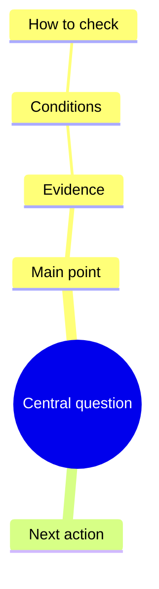

# Content format and editing

The editable source is a Markdown document containing exactly one fenced `mermaid` block, starting with `mindmap`. This is a deliberately limited interchange format, not the full Mermaid renderer or syntax.

````markdown
---
preset: MMB0Q4
---

# A useful question



Sources: actual URLs, chapters or code paths. Qualify uncertainty here.
````

Use spaces for indentation, one root, and plain text labels. `root((Title))` is supported. Labels become displayed text; do not add relation arrows, icon syntax, style classes or rich formatting. Put source notes outside the code fence; they remain in Markdown and saved HTML data, rather than becoming diagram nodes.

Generation follows the complexity of the content, without a fixed node quota or a default target size. Do not pad a small topic or truncate a complex one to meet a count. Folding, zoom and reading guidance adapt to the actual tree. Technical input guards remain:20 child levels (21 including root),500 characters per label and120000 source characters; these protect parsing and browser resources, and are not recommended generation sizes. Performance depends on the document and device.

Six-character alphanumeric style UIDs (e.g. MMK0V1) are permanent IDs, not list positions. Names select the same recipes, and legacy P IDs remain valid. See [UID registry](style-ids.md). The renderer normalizes the selected preset to a seven-part `style:` recipe when saving. An explicit command-line preset overrides source metadata. If both exist in source metadata, `style:` has priority over `preset:`. To switch a generated source, prefer `--preset` / `--switch-to` so stale recipe metadata does not override an edited name.

```bash
node skills/mindbox/scripts/render.cjs --input notes.md --output map.html --preset "彩虹经典"
node skills/mindbox/scripts/render.cjs --input map.html --switch-to "脑洞涂鸦"
```

The CLI reads editable data from Mindbox HTML without executing its scripts. It cannot turn arbitrary third-party HTML into a Mindbox document. Restyling preserves content; edit either the diagram nodes or the Markdown view. Both use one content model and preserve the same text, sibling order and hierarchy when switching views. Non-overwrite errors leave existing outputs intact. `--force` is explicit replacement; staged files and rollback protect against handled write/rename failures, not power loss or simultaneous writers.

After generation, maintain the latest saved HTML. Direct editing supports double-click/F2, Tab for a child, Enter for a sibling, Delete for a subtree, undo/redo and Ctrl/Command S to save. The reader has no import control or CRUD toolbar. See [HTML editing](html-editing.md).

HTML stores a canonical validated tree with stable IDs; Markdown is derived from it, retaining source notes. `--input map.html --extract` reads current content without executing scripts. Generated `mindbox_N["..."]` wrappers preserve literal labels resembling Mermaid shorthand. The old paired Markdown is a snapshot.

Exports contain all nodes regardless of temporary folding or panning:

| Export | Contract |
| --- | --- |
| PNG | Lossless image, at least2× target sampling and28px target text; bounded by32760px and64MP. |
| WebP animation | Content-based reading groups and focused24px target text, bounded by2560px and4MP; raster animation. |

The reading guide traverses hierarchy, not an invented causal chain. It does not make claims about the validity of the source content. Canvas/font/download support can vary by browser.
