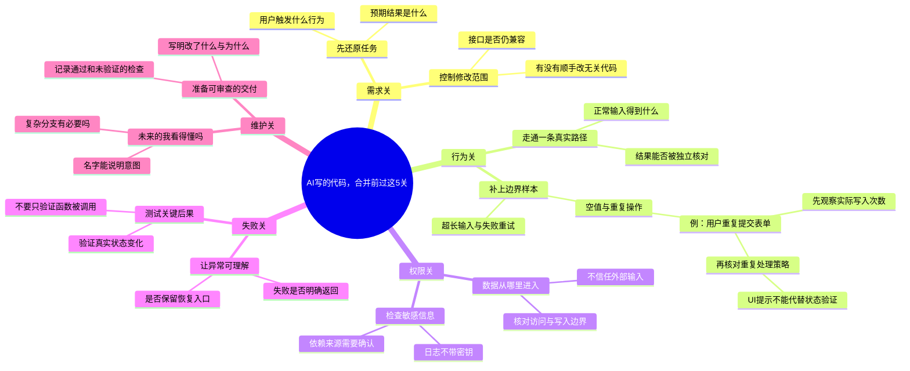

# AI写的代码，合并前过这5关

适合：开发者与技术写作者。
把差一点才正确，拆成可以逐项检查的交付问题。

这是Mindbox编辑的实践范例，不是效果承诺；时间安排与检查项可按实际情况修改。

选题信号（用于说明为何选这个问题，不代表该标题的流量预测）：
- [Stack Overflow · 2025 Developer Survey / AI](https://survey.stackoverflow.co/2025/ai) · 2025
- [Anthropic Economic Index · Cadences](https://www.anthropic.com/research/economic-index-june-2026-report) · 2026-06-26
