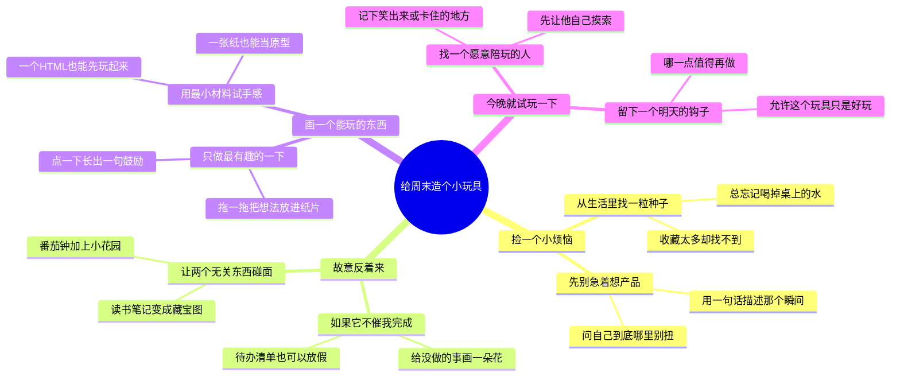

# 给周末造个小玩具

适合：自由构思者与好奇心玩家。
把一个小烦恼，反着想、画出来，再做一点点。

这是Mindbox编辑的实践范例，不是效果承诺；时间安排与检查项可按实际情况修改。

选题信号（用于说明为何选这个问题，不代表该标题的流量预测）：
- [Google · Year in Search 2025](https://blog.google/products-and-platforms/products/search/year-in-search-2025/) · 2025-12-04
- [Anthropic Economic Index · Cadences](https://www.anthropic.com/research/economic-index-june-2026-report) · 2026-06-26
