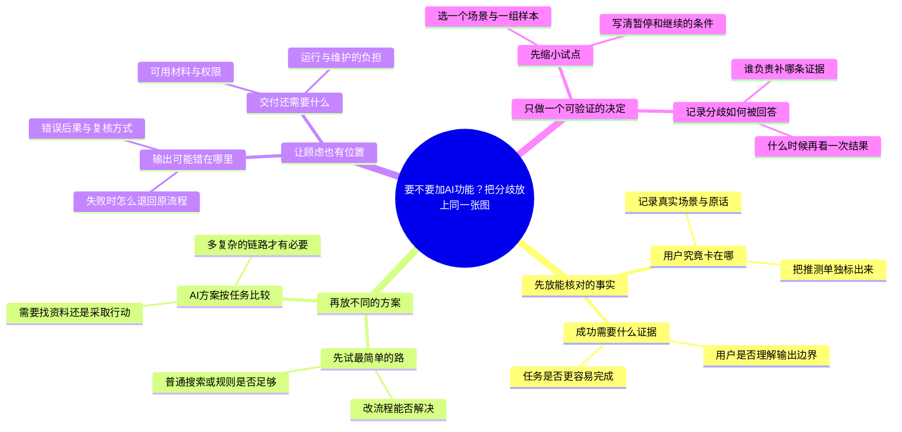

# 要不要加AI功能？把分歧放上同一张图

适合：研讨组织者与跨职能团队。
先对齐事实和未知，再比较方案与要验证的风险。

这是Mindbox编辑的实践范例，不是效果承诺；时间安排与检查项可按实际情况修改。

选题信号（用于说明为何选这个问题，不代表该标题的流量预测）：
- [Microsoft · Breaking down the infinite workday](https://www.microsoft.com/en-us/worklab/work-trend-index/breaking-down-infinite-workday) · 2025-06-17
- [Anthropic · Building effective agents](https://www.anthropic.com/engineering/building-effective-agents) · 2024-12-19
