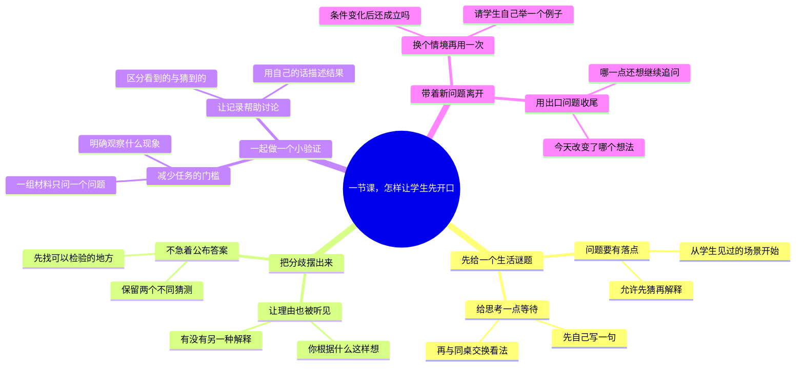

# 一节课，怎样让学生先开口

适合：教师与讲师。
从一个可回答的问题起步，把讲解变成一次共同探索。

这是Mindbox编辑的实践范例，不是效果承诺；时间安排与检查项可按实际情况修改。

选题信号（用于说明为何选这个问题，不代表该标题的流量预测）：
- [WEF · Future of Jobs 2025 / Skills outlook](https://www.weforum.org/publications/the-future-of-jobs-report-2025/in-full/3-skills-outlook/) · 2025-01
- [OpenAI · How people are using ChatGPT](https://openai.com/index/how-people-are-using-chatgpt/) · 2025-09-15
