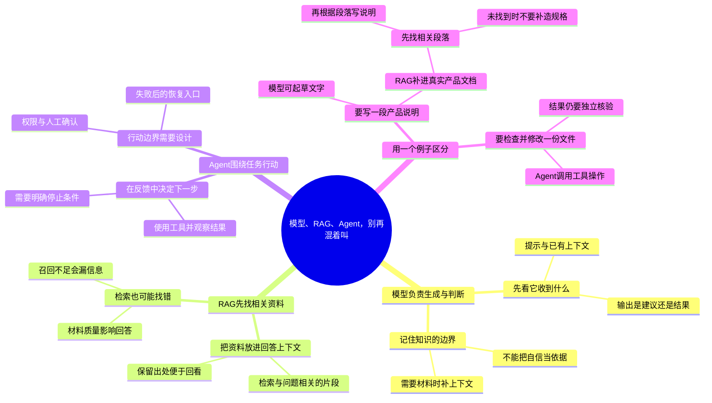

# 模型、RAG、Agent，别再混着叫

适合：技术讲师与概念解释者。
用一个任务区分生成、找资料和带着工具做事。

这是Mindbox编辑的实践范例，不是效果承诺；时间安排与检查项可按实际情况修改。

选题信号（用于说明为何选这个问题，不代表该标题的流量预测）：
- [Anthropic · Building effective agents](https://www.anthropic.com/engineering/building-effective-agents) · 2024-12-19
- [Stack Overflow · 2025 Developer Survey / AI](https://survey.stackoverflow.co/2025/ai) · 2025
