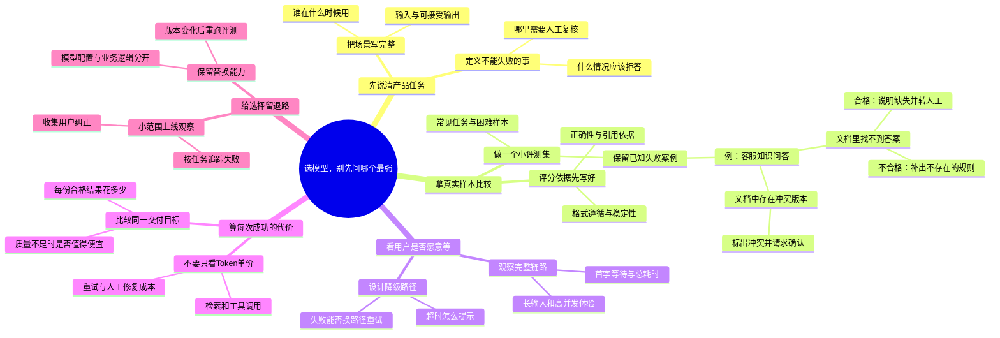

# 选模型，别先问哪个最强

适合：AI产品经理。
先定义任务与失败代价，再用自己的样本做选择。

这是Mindbox编辑的实践范例，不是效果承诺；时间安排与检查项可按实际情况修改。

选题信号（用于说明为何选这个问题，不代表该标题的流量预测）：
- [OpenAI · How people are using ChatGPT](https://openai.com/index/how-people-are-using-chatgpt/) · 2025-09-15
- [Stack Overflow · 2025 Developer Survey / AI](https://survey.stackoverflow.co/2025/ai) · 2025
- [Anthropic Economic Index · Cadences](https://www.anthropic.com/research/economic-index-june-2026-report) · 2026-06-26
