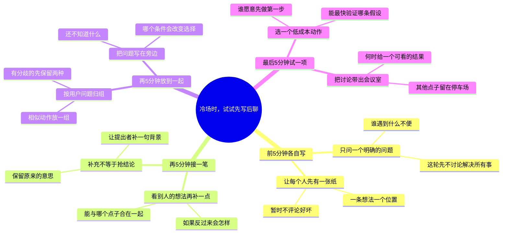

# 冷场时，试试先写后聊

适合：策划设计与共创组织者。
一个20分钟的示例议程，让点子先有位置，再开始判断。

这是Mindbox编辑的实践范例，不是效果承诺；时间安排与检查项可按实际情况修改。

选题信号（用于说明为何选这个问题，不代表该标题的流量预测）：
- [Microsoft · Breaking down the infinite workday](https://www.microsoft.com/en-us/worklab/work-trend-index/breaking-down-infinite-workday) · 2025-06-17
- [Google · Year in Search 2025](https://blog.google/products-and-platforms/products/search/year-in-search-2025/) · 2025-12-04
