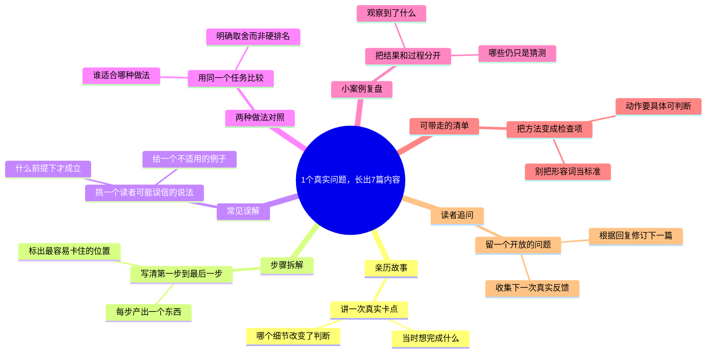

# 1个真实问题，长出7篇内容

适合：内容创作者与选题策划。
从读者的一个困惑出发，换七种角度，而不是换七个标题。

这是Mindbox编辑的实践范例，不是效果承诺；时间安排与检查项可按实际情况修改。

选题信号（用于说明为何选这个问题，不代表该标题的流量预测）：
- [OpenAI · How people are using ChatGPT](https://openai.com/index/how-people-are-using-chatgpt/) · 2025-09-15
- [Google · Year in Search 2025](https://blog.google/products-and-platforms/products/search/year-in-search-2025/) · 2025-12-04
