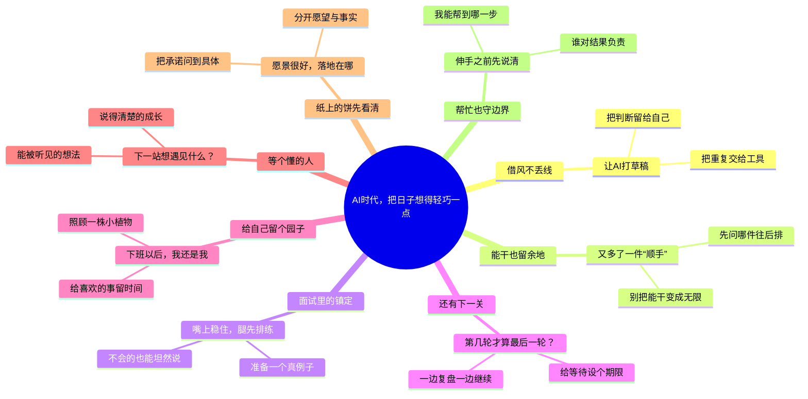

# AI时代，把日子想得轻巧一点

适合：打工人、求职者与日常记录者。
从AI助力、求职闯关到职场边界，把现实里的难题想得轻巧一点。

这是Mindbox编辑的生活随想范例，不是求职保证；装饰角色不表示节点的完成状态、优先级或对个人处境的判断。

选题信号（只说明主题背景，不是该标题的流量预测）：
- [WEF · Future of Jobs 2025 / Skills outlook](https://www.weforum.org/publications/the-future-of-jobs-report-2025/in-full/3-skills-outlook/) · 2025-01
- [OpenAI · How people are using ChatGPT](https://openai.com/index/how-people-are-using-chatgpt/) · 2025-09-15
