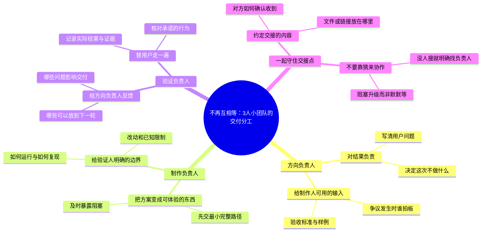

# 不再互相等：3人小团队的交付分工

适合：小团队负责人。
让每个人知道自己交付什么，下一位拿到什么。

这是Mindbox编辑的实践范例，不是效果承诺；时间安排与检查项可按实际情况修改。

选题信号（用于说明为何选这个问题，不代表该标题的流量预测）：
- [Microsoft · Breaking down the infinite workday](https://www.microsoft.com/en-us/worklab/work-trend-index/breaking-down-infinite-workday) · 2025-06-17
- [WEF · Future of Jobs 2025 / Skills outlook](https://www.weforum.org/publications/the-future-of-jobs-report-2025/in-full/3-skills-outlook/) · 2025-01
