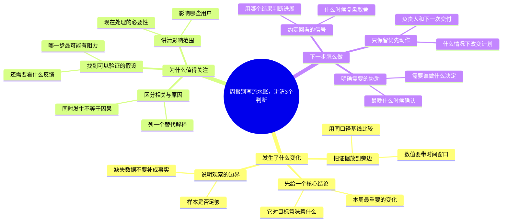

# 周报别写流水账，讲清3个判断

适合：产品运营与业务负责人。
把忙了什么，换成发生了什么、为什么、下一步怎么办。

这是Mindbox编辑的实践范例，不是效果承诺；时间安排与检查项可按实际情况修改。

选题信号（用于说明为何选这个问题，不代表该标题的流量预测）：
- [Microsoft · Breaking down the infinite workday](https://www.microsoft.com/en-us/worklab/work-trend-index/breaking-down-infinite-workday) · 2025-06-17
- [OpenAI · How people are using ChatGPT](https://openai.com/index/how-people-are-using-chatgpt/) · 2025-09-15
